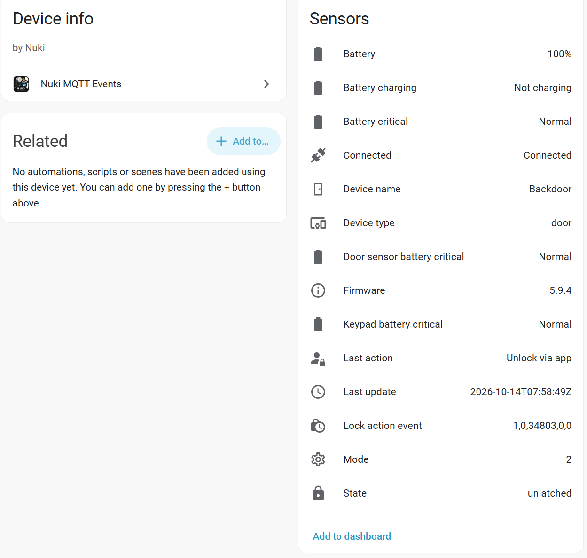

# Nuki MQTT Events

Take local control of your Nuki devices with Nuki MQTT Events, a Home Assistant custom integration that lets you monitor your devices and lock or unlock supported locks over local MQTT, with no external API needed.

You will still need the Nuki app to enable and configure MQTT on your device. Once configured, this integration communicates with your device locally over MQTT.

Once the integration is set up, you can also control supported locks remotely through the Home Assistant Companion app, provided remote access to your Home Assistant instance is configured.

It is available in the Home Assistant Community Store (HACS) and can be installed and updated directly through HACS.

> [!NOTE]
> This integration is not affiliated with or endorsed by Nuki. It is an independent, community-backed project based on publicly available documentation and APIs.

> [!IMPORTANT]
> This project was created primarily with the assistance of AI. It has been reviewed and tested by a professional programmer, but this disclosure is provided for transparency.

## Features

- Automatically subscribes to the default `nuki/#` MQTT topic pattern
- Supports complete multiline payloads and values published on individual topics
- Creates sensors for state, device name, device type, last update, firmware, battery percentage, mode, raw lock action event, and readable last action
- Creates binary sensors for connectivity, battery critical, battery charging, keypad battery critical, and door-sensor battery critical
- Creates an independent Home Assistant device and entity set for every Nuki device
- Adds a lock entity with lock/unlock controls for devices publishing native Nuki MQTT state topics

## Prerequisites

Before installing the integration:

1. Configure the built-in [Home Assistant MQTT integration](https://www.home-assistant.io/integrations/mqtt/).
2. Enable MQTT for your Nuki device in the Nuki app.
3. Confirm that your Nuki bridge or MQTT broker publishes messages under the Nuki MQTT namespace, typically `nuki/#`.
4. To use lock/unlock controls, enable MQTT command access in the Nuki app and allow Home Assistant's MQTT account to publish to `nuki/<device-id>/lockAction`. Status-only MQTT access is sufficient for monitoring.

## Installation with HACS

1. Open **HACS** in Home Assistant.
2. Search for **Nuki MQTT Events** and download it.
3. Restart Home Assistant.
4. Go to **Settings > Devices & services** and click **Add integration**.
5. Search for **Nuki MQTT Events** and complete the setup.

The integration automatically subscribes to the Nuki MQTT namespace; no manual topic entry is required.
Only one integration entry is allowed; it handles all Nuki devices. Adding it again
is blocked to prevent duplicate MQTT subscriptions and entities.

### Updating an existing installation

Lock/unlock control is available in stable version **0.5.0** and later.

1. Open **HACS > Nuki MQTT Events** and install the latest stable version.
2. If the update is not listed, use the three-dot menu to select **Update information**, then **Redownload** and explicitly select the stable version.
3. Restart Home Assistant after downloading. Reloading the integration alone does not replace code already loaded by Home Assistant.
4. Keep the existing integration entry; there is no need to remove it or add another one.

If upgrading from `0.5.0b1`, select `v0.5.0` or a newer stable release.
Beta versions do not need to remain enabled in HACS.

## Supported MQTT message formats

The integration supports complete multiline Nuki key/value payloads and brokers that publish each field on its own topic, such as `nuki/4CFF3164/connected` with the payload `true`.

Example complete payload:

```text
▼ 4CFF3164
connected = true
timestamp = 2026-10-13T17:45:01Z
deviceType = 5
name = Backdoor
firmware = 5.9.4
batteryChargeState = 100
batteryCritical = false
batteryCharging = false
keypadBatteryCritical = false
doorSensorBatteryCritical = false
state = 3
mode = 2
lockActionEvent = 1,0,87501,8192,1
```

The integration:

- converts `true` / `false` to boolean values
- converts numeric values to integers or floating-point numbers
- maps `state` to a Home Assistant-friendly value such as `locked`, `unlocked`, `unlatched`, or `disconnected`
- decodes `lockActionEvent` into a readable value such as `Unlock by Koenraad via app` or `Unlock by Koenraad via keypad`

## Naming app and keypad users

The `lockActionEvent` payload uses the format `action,trigger,authorization ID,code ID,detail`. App users normally use the authorization ID, while keypad users use the code ID.

To map these IDs to names, add the following to your Home Assistant `configuration.yaml`:

```yaml
nuki_mqtt_events: !include nuki_mqtt_events.yaml
```

Create `nuki_mqtt_events.yaml` in the same directory:

```yaml
authorization_names:
  "87501": Koenraad
  "87502": Alice
  "87503": Bob

code_names:
  "8192": Koenraad
  "8193": Alice
  "8194": Cleaner
```

Add as many authorization and code IDs as needed, then restart Home Assistant. To discover the IDs, trigger the lock once and inspect the `authorization_id` and `code_id` attributes of the **Last action** sensor. This sensor also exposes the decoded action, trigger, source, and keypad input type as attributes.

An example configuration is available in [`examples/nuki_mqtt_events.yaml`](examples/nuki_mqtt_events.yaml).

## Lock and unlock control

When a device publishes `state` on `nuki/<device-id>/state`, the integration
creates a **Lock/Unlock** entity on the same Home Assistant device as its sensors.
Complete payloads on `nuki/<device-id>` are also supported, provided the publisher
accepts native Nuki commands on `nuki/<device-id>/lockAction`.
Read-only bridges or publishers using a different command API are not supported
for control.

Enable MQTT command access in the Nuki app (not just status reporting), and
ensure the Home Assistant MQTT account can publish to the command topic.
The entity provides Home Assistant's standard lock/unlock controls and actions:

- **Lock** publishes `2` to `nuki/<device-id>/lockAction`.
- **Unlock** publishes `1` to that topic. It does not send the separate unlatch command.

### Using the controls in Home Assistant

1. Open **Settings > Devices & services > Nuki MQTT Events** and select the Nuki device.
2. Find its **Lock** entity in the **Controls** section. The **State** sensor is read-only; use the lock entity to operate the lock.
3. Open the lock entity for its controls, or use **Add to dashboard** to add it to a dashboard.

The lock entity also supports the standard `lock.lock` and `lock.unlock` actions
in Home Assistant automations and scripts. Select the entity belonging to the
door you want to control.

The entity is created after the device publishes its first state message.
If necessary, operate the lock through the Nuki app to trigger an update.

### Command behavior and safety

Commands use QoS 0 and are **never retained**, so a new command is not stored
for replay on reconnect. Adding the integration or restarting Home Assistant
does not send commands. State only changes when Nuki reports it; publishing a
command is not confirmation that it succeeded. If command access is disabled,
the state may remain unchanged. Known device or broker disconnections make
the entity unavailable and block commands.

For a first test, keep another way to access the door available, restart Home
Assistant after installing or updating the integration, and wait for a state message to discover
the lock entity. Test while physically near the lock. Do not enable automations
until you have verified both controls and the reported state.

State codes follow the [Nuki MQTT API](https://developer.nuki.io/t/mqtt-api-specification-v1-2/17283):
`1` locked, `2` unlocking, `3` unlocked, `4` locking, `5` unlatched,
`6` unlocked (Lock 'n' Go), `7` unlatching, and `254` motor blocked (jammed).
Uncalibrated, startup, undefined, and unrecognized codes do not report a confirmed
locked/unlocked state.

### Troubleshooting missing controls

If the device page only shows sensors:

1. Confirm HACS has downloaded version **0.5.0** or later, then restart Home Assistant.
2. In the Home Assistant configuration directory, verify that `custom_components/nuki_mqtt_events/lock.py` exists and that `PLATFORMS` in `const.py` includes `"lock"`. If not, redownload the stable version explicitly; do not only edit the platform list.
3. In the MQTT integration's configuration, listen to `nuki/#` and confirm the device publishes a numeric state on `nuki/<device-id>/state`, or a complete payload containing `state` on `nuki/<device-id>`.
4. Check **Settings > System > Logs** for errors mentioning `nuki_mqtt_events` or the lock platform.

If the entity appears but commands have no effect, verify command access in the
Nuki app and broker publish permissions. A read-only publisher cannot be made
controllable by enabling the entity alone.

## Entities

For the sample payload above, the integration creates up to 15 entities: nine sensors, five binary sensors, and one lock. Entities are created when their values are first published.



- **State** maps the numeric Nuki `state` value to a readable state.
- **Lock** provides lock/unlock controls and reports confirmed lock state, transitions, and motor-blocked (jammed) status.
- **Last action** decodes the five-part `lockActionEvent`.
- **Lock action event** retains the raw event.
- **Device name** exposes the name reported by Nuki.
- Each boolean field is available as its own binary sensor.

Each Nuki device gets its own Home Assistant device and entity set. Entity names use the `name` value from the MQTT payload when available, such as `Backdoor State`. Until a name is received, the integration uses the device segment of the MQTT topic, such as `4CFF3164 State`. This prevents messages from multiple Nuki devices from overwriting one another.

## Versioning

This project follows [semantic versioning](https://semver.org/) (`MAJOR.MINOR.PATCH`) and uses GitHub Releases for published builds.

## License

MIT
